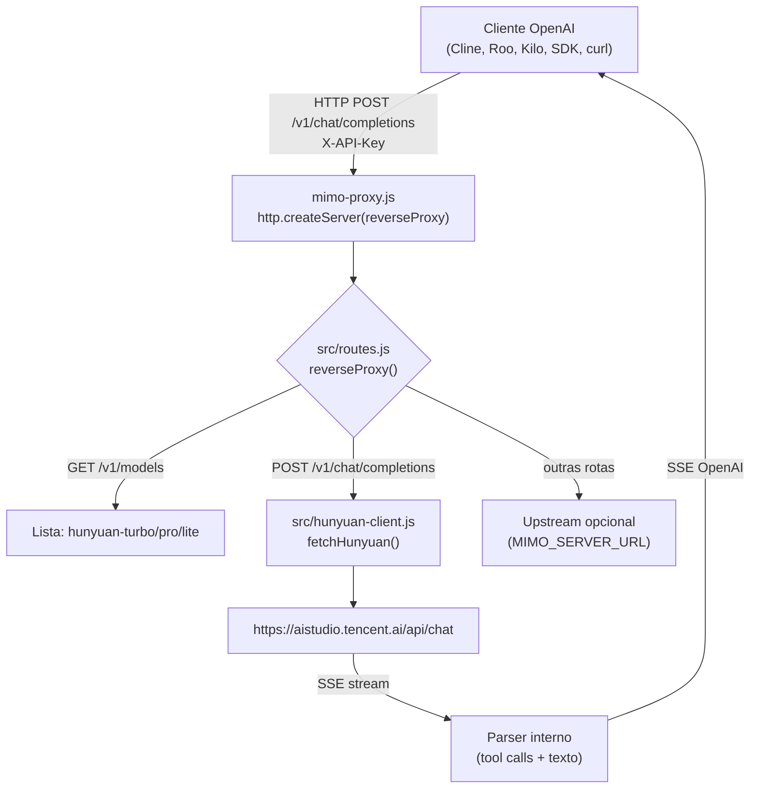

# Hunyuan Proxy

Proxy reverso para o modelo **Hunyuan da Tencent**, expondo uma **API compatível com OpenAI** (`/v1/chat/completions`, `/v1/models`).

O proxy recebe requisições no formato OpenAI, converte para o formato esperado pela API interna da Tencent (aistudio.tencent.ai), executa a requisição com os cookies/headers de autenticação, e traduz a resposta (incluindo tool calls em streaming) de volta para o formato OpenAI SSE.

---

## 1. TL;DR

| Pergunta | Resposta |
|---|---|
| Qual é o entrypoint? | `mimo-proxy.js` → `createServer(reverseProxy)` na porta `config.port` |
| Qual é o caminho quente? | `src/routes.js` → `reverseProxy()` → `fetchHunyuan()` em `src/hunyuan-client.js` |
| Onde fica a lógica de chat? | `src/hunyuan-client.js` (fetch HTTP + parsing SSE + tool calls) |
| Como configuro autenticação? | Variáveis `TENCENT_COOKIE` e `TENCENT_API_URL` no `.env` |
| Como testo? | `npm test` (83 testes) e `npm run lint` |
| Precisa de navegador/Playwright? | **Não** — usa `fetch` nativo do Node.js |
| Node? | **Node 20+** (usa `crypto.randomUUID()` global) |

---

## 2. Arquitetura



### Fluxo de uma requisição

1. Cliente envia `POST /v1/chat/completions` com formato OpenAI
2. `reverseProxy` valida auth e chama `fetchHunyuan(response, data)`
3. `fetchHunyuan`:
   - Converte `messages` + `tools` para prompt único no formato esperado pelo Hunyuan
   - Monta payload JSON para `TENCENT_API_URL`
   - Faz `fetch` com `Cookie` e `User-Agent` da Tencent
   - **Streaming**: lê o stream, extrai tool calls em tempo real, emite SSE OpenAI
   - **Non-streaming**: lê resposta completa, extrai tool calls, retorna JSON OpenAI
4. Resposta chega ao cliente no formato OpenAI padrão

---

## 3. Configuração

Copie `.env.example` para `.env` e preencha:

```bash
cp .env.example .env
```

### Variáveis obrigatórias

| Variável | Descrição |
|---|---|
| `HUNYUAN_PROXY_TOKEN` | Token secreto para autenticação do proxy (header `X-API-Key`) |
| `TENCENT_COOKIE` | Cookies de sessão da Tencent (obtidos do navegador logado no aistudio.tencent.ai) |
| `TENCENT_API_URL` | Endpoint da API (default: `https://aistudio.tencent.ai/api/chat`) |

### Variáveis opcionais

| Variável | Default | Descrição |
|---|---|---|
| `HUNYUAN_PROXY_PORT` | `8787` | Porta do servidor |
| `HUNYUAN_PROXY_HOST` | `0.0.0.0` | Host de escuta |
| `HUNYUAN_PROXY_REQUIRE_AUTH` | `true` | Se `false`, desabilita auth |
| `TENCENT_USER_AGENT` | Chrome UA padrão | User-Agent enviado à Tencent |
| `HUNYUAN_UPSTREAM_URL` | `http://127.0.0.1:4096` | Upstream para rotas não `/v1/*` |
| `HUNYUAN_UPSTREAM_PASSWORD` | vazio | Senha Basic auth para upstream |

---

## 4. Como obter o `TENCENT_COOKIE`

1. Acesse `https://aistudio.tencent.ai` no navegador e faça login
2. Abra as Ferramentas de Desenvolvedor (F12) → aba **Network** → filtre por **Fetch/XHR**
3. Faça uma pergunta no chat
4. Clique na requisição para `api/chat` → aba **Headers** → **Request Headers** → **Cookie**
5. Copie todo o valor do Cookie e cole no `.env` como `TENCENT_COOKIE=...`

> **Nota:** Os cookies expiram. Quando der erro 401/403, repita o processo.

---

## 5. API HTTP Exposta

| Método | Rota | Descrição | Auth |
|---|---|---|---|
| `GET` | `/v1/models` | Lista modelos suportados | `X-API-Key` |
| `POST` | `/v1/chat/completions` | Chat completion (streaming ou não) | `X-API-Key` |
| `*` | outras | Proxy para `HUNYUAN_UPSTREAM_URL` | `X-API-Key` |

### Exemplo — Non-streaming

```bash
curl -s http://localhost:8787/v1/chat/completions \
  -H 'Content-Type: application/json' \
  -H 'X-API-Key: seu-token' \
  -d '{
    "model": "hunyuan-turbo",
    "messages": [
      {"role": "system", "content": "Responda em português."},
      {"role": "user", "content": "Diga oi"}
    ]
  }'
```

Resposta:
```json
{
  "id": "chatcmpl-abc123",
  "object": "chat.completion",
  "created": 1700000000,
  "model": "hunyuan-turbo",
  "choices": [{
    "index": 0,
    "message": { "role": "assistant", "content": "Oi! Como posso ajudar?" },
    "finish_reason": "stop"
  }],
  "usage": { "prompt_tokens": 10, "completion_tokens": 5, "total_tokens": 15 }
}
```

### Exemplo — Streaming

```bash
curl -N http://localhost:8787/v1/chat/completions \
  -H 'Content-Type: application/json' \
  -H 'X-API-Key: seu-token' \
  -d '{"model":"hunyuan-turbo","stream":true,"messages":[{"role":"user","content":"Conte uma história"}]}'
```

Resposta (SSE):
```text
data: {"id":"chatcmpl-abc123","object":"chat.completion.chunk","created":1700000000,"model":"hunyuan-turbo","choices":[{"index":0,"delta":{"role":"assistant"},"finish_reason":null}]}

data: {"id":"chatcmpl-abc123","object":"chat.completion.chunk","created":1700000000,"model":"hunyuan-turbo","choices":[{"index":0,"delta":{"content":"Era uma vez"},"finish_reason":null}]}

data: {"id":"chatcmpl-abc123","object":"chat.completion.chunk","created":1700000000,"model":"hunyuan-turbo","choices":[{"index":0,"delta":{},"finish_reason":"stop"}]}

data: [DONE]
```

### Tool Calling (Function Calling)

O proxy suporta **tool calls em streaming e non-streaming**. Envie `tools` no formato OpenAI:

```bash
curl -s http://localhost:8787/v1/chat/completions \
  -H 'Content-Type: application/json' \
  -H 'X-API-Key: seu-token' \
  -d '{
    "model": "hunyuan-turbo",
    "messages": [{"role": "user", "content": "Qual a temperatura em São Paulo?"}],
    "tools": [{
      "type": "function",
      "function": {
        "name": "get_weather",
        "description": "Obtém clima atual",
        "parameters": {
          "type": "object",
          "properties": {
            "location": {"type": "string", "description": "Cidade"}
          },
          "required": ["location"]
        }
      }
    }],
    "tool_choice": "auto"
  }'
```

Se o modelo chamar a tool, a resposta incluirá `tool_calls`:

```json
{
  "choices": [{
    "message": {
      "role": "assistant",
      "content": null,
      "tool_calls": [{
        "id": "call_abc123",
        "type": "function",
        "function": { "name": "get_weather", "arguments": "{\"location\":\"São Paulo\"}" }
      }]
    },
    "finish_reason": "tool_calls"
  }]
}
```

> **Como funciona:** O proxy injeta as tools no prompt como JSON + instrução para o modelo retornar `{"name": "...", "arguments": {...}}`. O parser intercepta o stream, detecta o JSON da tool call, e emite o chunk OpenAI `delta.tool_calls` em tempo real.

---

## 6. Modelos Suportados

| ID | Descrição |
|---|---|
| `hunyuan-turbo` | Modelo balanceado (padrão) |
| `hunyuan-pro` | Modelo mais capaz |
| `hunyuan-lite` | Modelo rápido/leve |

O parâmetro `model` da requisição é passado para o proxy (usado no `id` da resposta), mas o modelo real chamado na Tencent é configurado no payload (`gpt_175B_0404` / `hy4-g`).

---

## 7. Como Rodar

### Pré-requisitos
- **Node.js 20+**
- **npm**

### Instalação
```bash
npm install
cp .env.example .env
# edite .env com seu TENCENT_COOKIE e HUNYUAN_PROXY_TOKEN
```

### Iniciar
```bash
npm start
# ou
node mimo-proxy.js
```

O servidor sobe em `http://0.0.0.0:8787`.

### Testar
```bash
curl -s http://localhost:8787/v1/models \
  -H 'X-API-Key: seu-token'

curl -s http://localhost:8787/v1/chat/completions \
  -H 'Content-Type: application/json' \
  -H 'X-API-Key: seu-token' \
  -d '{"model":"hunyuan-turbo","messages":[{"role":"user","content":"Olá"}]}'
```

---

## 8. Testes e Lint

```bash
npm run lint   # node --check
npm test       # node --test (83 testes)
```

Os testes são puros (não sobem servidor nem fazem requisições externas).

---

## 9. Estrutura de Arquivos

```
hunyuan-proxy/
├── mimo-proxy.js              # Entrypoint: createServer(reverseProxy)
├── .env.example               # Exemplo de configuração
├── src/
│   ├── config.js              # Parse .env + validação lazy
│   ├── routes.js              # Roteador: /v1/models, /v1/chat/completions, proxy
│   ├── hunyuan-client.js      # fetchHunyuan: fetch + SSE parsing + tool calls
│   ├── auth.js                # isAuthorized, readBody, deny, bad
│   ├── openai.js              # Formatadores OpenAI, tokens, SSE
│   └── tool-handler.js        # Extração de tool calls por regex (4 formatos)
├── test/
│   ├── auth.test.js
│   ├── openai.test.js
│   ├── server.test.js
│   ├── streaming.test.js
│   └── tools.test.js
└── package.json
```

---

## 10. Limitações Conhecidas

1. **Cookies expiram** — `TENCENT_COOKIE` precisa ser atualizado periodicamente
2. **Sem health check local** — `/healthz` vai para o upstream opcional
3. **Body sem limite** — requisições grandes consomem memória
4. **Tool calling depende do modelo** — o Hunyuan precisa seguir a instrução de emitir JSON puro; se não emitir, `detectFakeToolCalls` avisa
5. **Modelo real fixo** — o payload para a Tencent usa `gpt_175B_0404` / `hy4-g` hardcoded
6. **Logs verbosos** — em produção, considere reduzir o nível de log

---

## 11. Segurança

- **Não exponha na internet sem TLS** — use um reverse proxy (nginx, Caddy) com HTTPS
- `HUNYUAN_PROXY_TOKEN` deve ser forte e rotacionado
- `TENCENT_COOKIE` dá acesso à sua conta Tencent — trate como senha
- Não commite `.env` nem cookies

---

## 12. Licença

MIT